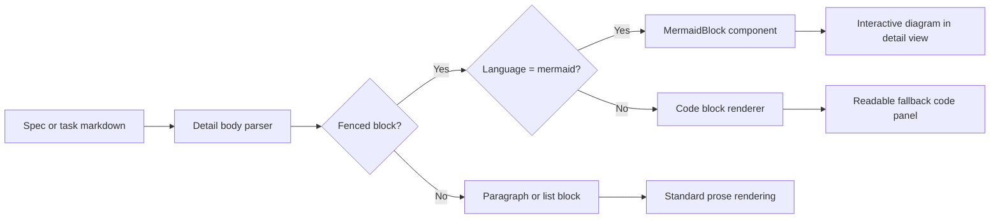
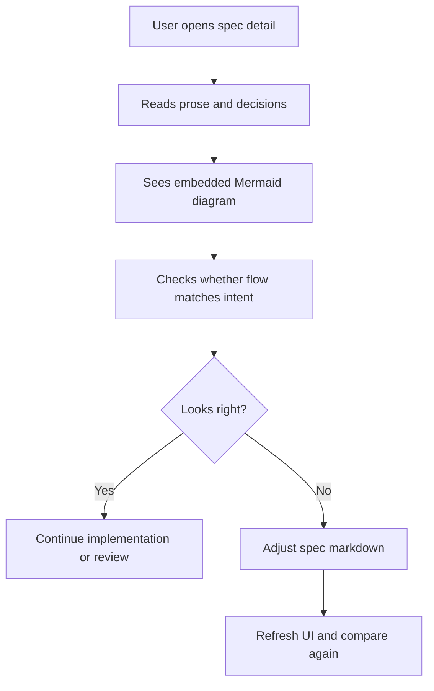

+++
doc_kind = "spec"
id = "SPEC-011"
title = "Render diagram blocks in spec and task detail views"
summary = "Support fenced Mermaid diagrams and related code/chart blocks in spec and task details so the UI can display richer planning artifacts directly from repo docs."
status = "done"
task_ids = ["TASK-033", "TASK-034"]
tags = ["ui", "docs", "mermaid"]
updated_at = "2026-04-03T21:20:00.000Z"
+++

# Problem

Spec and task details already hold rich planning context, but before this slice they flattened all fenced blocks into plain text. That made diagram-oriented specs much less useful in the UI because:

- Mermaid flowcharts could not be previewed where the user was already reading the spec.
- Agents and humans could not quickly validate whether a diagram matched the prose around it.
- Rich planning artifacts lived in the markdown source, but the UI did not honor them as first-class detail content.

The result was a gap between docs-as-code authoring and UI-based review.

# Goals

- Preserve fenced code blocks deterministically when parsing spec and task bodies.
- Render Mermaid blocks as diagrams inside spec and task detail views.
- Let users zoom in, zoom out, and reset Mermaid diagrams while staying inside the detail view.
- Let users resize the Mermaid viewport itself and scroll inside it when a diagram exceeds the available area.
- Keep non-Mermaid fenced blocks readable as code so nothing is lost when the UI cannot interpret a block semantically.
- Make diagram support graceful rather than brittle: if Mermaid fails, the raw source should still be visible.

## Rendering Flow

## User Value Flow

# Non-Goals

- Introduce a generic plugin system for arbitrary diagram engines.
- Render diagrams in every summary surface such as Dash, Kanban, or Timeline.
- Auto-generate diagrams from prose.
- Make Mermaid support editable in-place from the UI in this slice.

# Functional Notes

- Mermaid support is sourced from ordinary fenced markdown blocks using the `mermaid` language tag.
- Diagram rendering belongs in detail views because those are the places where full document context already exists.
- The parser should stay deterministic and structural; interpretation happens later in the UI layer.
- If a diagram cannot render, the user should still be able to inspect the original source block.
- Diagram controls should feel lightweight and local to the block, not like a separate editing mode.
- The viewport should support more compressed inspection too, including a zoom floor around 30%.

# Acceptance Criteria

- A spec or task with a fenced `mermaid` block renders a visible diagram in its detail page.
- The rendered Mermaid block can be zoomed in, zoomed out, and reset without leaving the detail page.
- The Mermaid viewport can be resized by the user and scrolls when the diagram overflows.
- A fenced block with another language still renders as readable code.
- The document parser preserves block order so prose and diagrams remain interleaved correctly.
- A Mermaid rendering failure does not make the detail page unusable.
